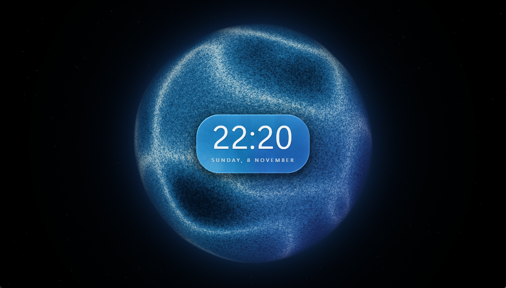
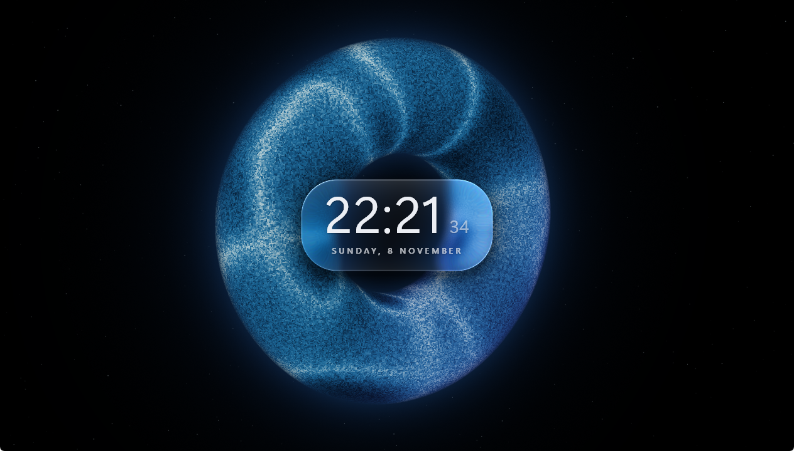
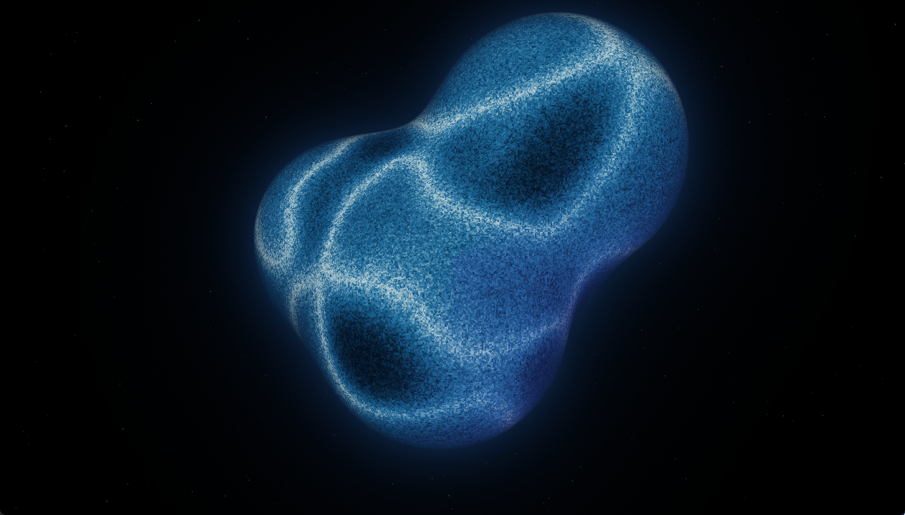
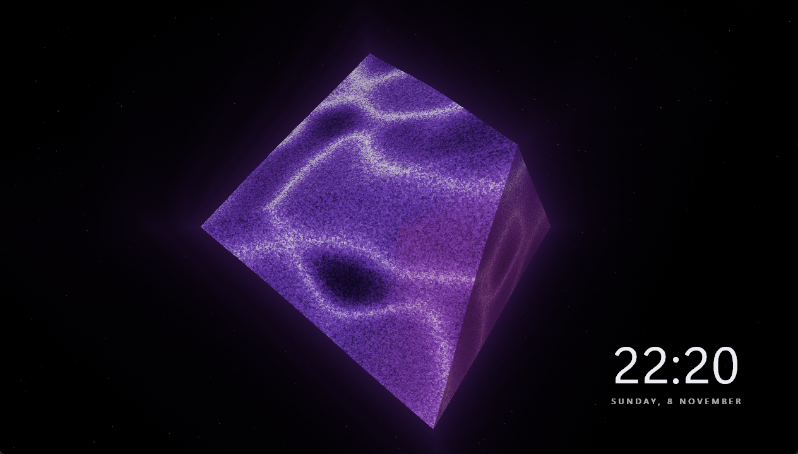
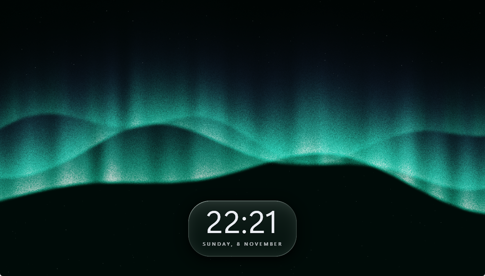
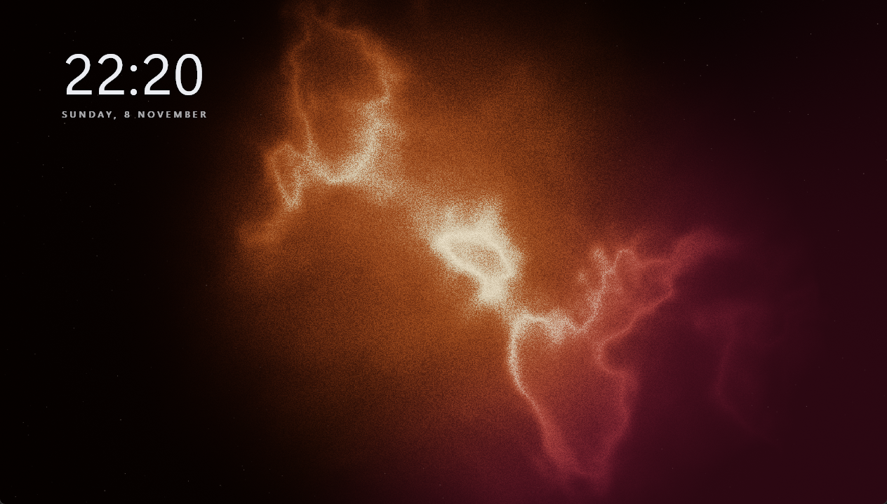

# Orb

An animated, glowing particle orb with a **liquid-glass clock**, made for a second monitor.
It renders on a **true-black background**, so on an OLED/AMOLED screen everything that isn't lit stays off.

Native Windows app, a single ~340 KB `.exe` with nothing to install (Win32 + Direct3D 11).



| | |
|---|---|
|  |  |
|  |  |



## Download

Get **`Orb.exe`** from the [latest release](../../releases/latest), put it anywhere and run it.
Requires Windows 10/11 and a DirectX 11 graphics card. Because the exe isn't code-signed,
Windows SmartScreen may ask for confirmation the first time: choose *More info → Run anyway*.

## Features

- **7 forms**: Orb, Blob, Ring, Cube and Crystal are raymarched 3D shapes that **morph** smoothly into each other. Aurora and Nebula are full-screen effects. Auto-morph cycles through the 3D forms by itself.
- **Liquid-glass clock**: a frosted panel that refracts and bends what's behind it, with a chromatic rim, sheen and shadow. Choose Glass, Minimal (text only) or Off. 7 positions, 12/24-hour time, optional seconds and date, adjustable size, frost and refraction.
- **Reacts to sound**: it listens to whatever the PC is playing (music, videos), and the orb pulses with the bass and ripples faster with the volume. Auto-gain plus a sensitivity slider. Nothing is recorded.
- **Looks**: 6 palette presets plus 4 custom colours, color cycling, twinkling stars, particle grain, glow, contrast and more.
- **Screen-friendly**: anti burn-in drift slowly moves the orb and clock. Pure-black background. FPS cap and render resolution for lighter use.
- Remembers its settings, its monitor and whether it was fullscreen.

## Controls

| Key | Action |
|---|---|
| `H` or right-click | Settings panel |
| `F`, `F11`, `Alt+Enter` or double-click | Fullscreen (on the monitor the window is on) |
| `1` – `7` | Orb, Blob, Ring, Cube, Crystal, Aurora, Nebula |
| `M` | Auto-morph on/off |
| `C` | Clock style: Off, Minimal, Glass |
| `A` | React to sound on/off |
| `Space` | Pause |
| `Esc` | Close settings / leave fullscreen |

Settings are saved in `%APPDATA%\Orb\orb.ini`. Set the `ORB_INI` environment variable to use a different file.

## Building from source

Needs MinGW-w64 GCC (e.g. `winget install BrechtSanders.WinLibs.POSIX.UCRT`) on `PATH`:

```bat
native\build.bat
```

This produces `native\Orb.exe`. Everything is in [`native/orb.cpp`](native/orb.cpp), including the HLSL shader.
`orb.html` is the original browser (WebGL) prototype, with fewer features.
